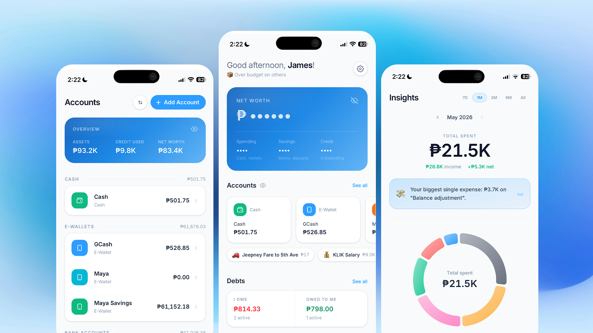

<div align="center">
  
  <h1>Spendr</h1>
  <p>A personal finance app for the Philippines: log what you spend in seconds, see where it goes, and keep more of it. Works offline, installs like an app, and syncs across your devices.</p>
  <p><a href="https://spendr-v2.vercel.app">spendr-v2.vercel.app</a></p>
</div>



## What it does

- **Accounts the way you have them:** cash, GCash and Maya, banks, credit cards
  with their statements and due dates, loans and investments, in any currency.
- **Fast logging:** expense, income or transfer, or type "150 jollibee" into
  quick log. Spendr remembers which category a description goes under.
  Templates, splits, refunds and installment plans are built in.
- **Budgets:** monthly limits per category, with leftovers rolled over or
  moved into savings.
- **Bills and pay:** recurring bills with reminders, and a forecast of what's
  safe to spend until payday that learns when your pay comes in.
- **Saving:** goals funded by your real balances, a wishlist that makes you
  wait before you buy, and no-spend challenges.
- **Debts:** who owes you and whom you owe, with partial payments.
- **Insights:** spending by category, trends, net worth, and a monthly Wrapped.
- **Yours to keep:** works without a connection, backs up to a file, imports
  and exports CSV, locks with Face ID, and deletes your account from inside
  the app.

## Run it

```bash
npm ci
cp .env.example .env    # your Supabase URL and anon key; leave blank to run without sync
npm run dev             # http://localhost:5173
```

Without Supabase settings the app runs fully on the device, signed out.

### Supabase (for sign-in and sync)

1. Create a project, and copy its URL and anon key into `.env`.
2. Run every file in `supabase/migrations/`, in number order, in the SQL
   editor. Each one is safe to run twice.
3. Turn on Google under Authentication › Providers.
4. For push reminders, deploy `supabase/functions/send-reminders` (its header
   lists the secrets it needs; `node scripts/vapid-keys.mjs` makes the keys).

## Checks

```bash
npm run check   # types, plus AST checks: unbound names, use before declaration,
                # hooks after an early return, broken imports, hand-rolled UI,
                # em dashes in copy
npm test        # vitest
npm run lint
npm run build
```

CI runs the same four on every push (`.github/workflows/ci.yml`).

## Project layout

```text
src/
  pages/        the phone's pages; a folder when a page has parts
  web/          the computer's layout and its own pages
  components/   shared components; ui/ is the design system
  lib/          domain rules (sync, budgets, forecast, help centre, ...)
  db/           the local database (Dexie) and the writes to it
  utils/  hooks/  context/  layouts/
supabase/
  migrations/   numbered SQL, run by hand in order
  functions/    the push reminder function
site/           the landing page (Astro)
scripts/        checks/ (npm run check), tools/ (one-off code edits), build helpers
docs/           how it's built, how releases work, and old plans
dev/            dev-only pages (local/ is not tracked)
```

More in [docs/architecture.md](docs/architecture.md).

## Versions

Semantic versioning from 1.0.0: MAJOR for changes people have to relearn,
MINOR for anything new, PATCH for fixes. See
[docs/releasing.md](docs/releasing.md).

## Built with

React 18, Vite 6, Tailwind CSS 4, Dexie 4 (IndexedDB), Supabase (Postgres,
row-level security, Realtime), Motion, Recharts, Tiptap, react-pdf, and
vite-plugin-pwa.

## License

© 2024–2026 James Sablay. All rights reserved.
